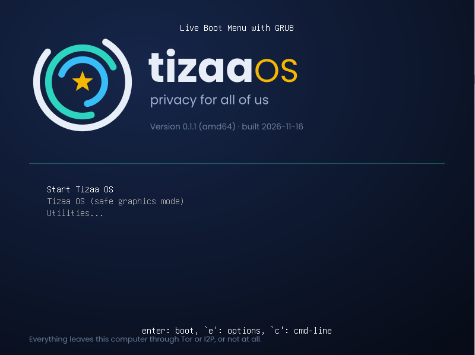
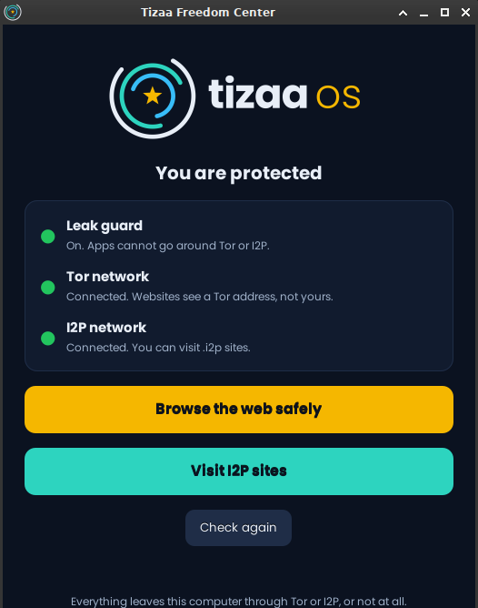
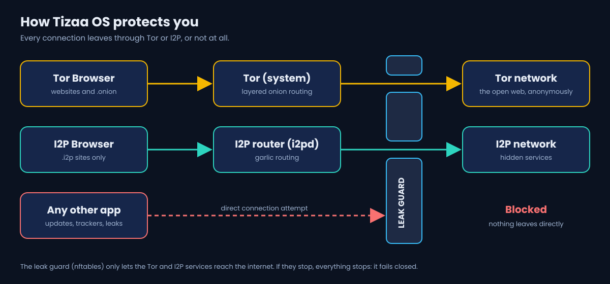

  

  
  
  
  

# Tizaa OS™

**Privacy anyone can use.**

Plug in. Start. You're protected. Tizaa OS sends everything through **Tor** or **I2P**, or not at all.

✅ No tech skills &nbsp;·&nbsp; ✅ No setup &nbsp;·&nbsp; ✅ No leaks

🌍 **Website:** [tizaa.org](https://tizaa.org) &nbsp;·&nbsp; ⬇️ **Download:** [Releases](../../releases) &nbsp;·&nbsp; 💡 **Ideas & testing:** [tizaa.org/#community](https://tizaa.org/#community)

## Why "Tizaa"?

*Ti zaa* means **"all of us"** in Dagbanli, a language of northern Ghana. Everybody deserves privacy and secure communication, not only the few who know how to configure it.

## What's inside (0.1.2)

| | |
|---|---|
| 🛡️ **Leak guard** | Only Tor and I2P can go online. If they stop, everything stops. |
| 🌐 **Tor Browser** | The web and .onion sites, anonymously. |
| 🧄 **I2P Browser** | The invisible internet, sealed off from everything else. |
| 🟢 **Freedom Center** | One window, three green lights, plain words. |
| 💾 **Leaves no trace** | Runs in memory from a USB stick and forgets everything at shutdown. |
| 🔐 **Encrypted install** | Install on your laptop with full-disk encryption. |
| 🪪 **Fresh identity** | No keys or personal data ship in the image; every machine creates its own. |
| ✔️ **Verifiable** | Open source, with a published SHA-256 fingerprint for every release. |

## Screenshots

  
  

  

## How it works

  

## Who it's for

**Everyone under censorship or surveillance:** journalists and their sources, whistleblowers, dissidents, activists, human-rights defenders, researchers, and all of us who simply want privacy without becoming experts.

## Vision

Tizaa OS is the first step of a larger, long-term privacy ecosystem.

| Today | Next | Future |
|---|---|---|
| Tizaa OS for desktops and laptops | Works even where the internet is censored, with more protection built in | Tizaa on phones, in local languages worldwide |

Follow progress at [tizaa.org](https://tizaa.org).

## Try it

1. Download the ISO from [Releases](../../releases) and verify it:
   - Windows: `certutil -hashfile tizaa-os-0.1.2-amd64.hybrid.iso SHA256`
   - Linux/macOS: `sha256sum -c SHA256SUMS` (with both files in the same folder)
   - The result must match: `534f36742bdfb8d6534fedbd79c2ad96a11dd13831c454e48a5b081ca0b5e71f`
2. **VirtualBox:** Linux / Debian (64-bit), tick **Skip Unattended Installation**, 4 GB RAM, **EFI on**, VMSVGA with 128 MB video. Choose **Start Tizaa OS**.
3. **USB stick:** write the ISO with a tool such as [balenaEtcher](https://etcher.balena.io/) and boot from it.

Live session: user `tizaa`, password `live` (logs in automatically; the password is only needed for administrator tasks).

## Project status

**Development preview.** Tizaa OS is in active development toward 1.0, which will include an independent security audit. Try it, test it, and tell us what you find.

## Get involved

- **Test early versions** or **share an idea:** [tizaa.org/#community](https://tizaa.org/#community)
- **Report a bug:** [open an issue](../../issues)
- **Partners and funders:** we welcome support for an independent security audit, translations, hardware testing and the mobile platform. Get in touch through [tizaa.org](https://tizaa.org/#community) ("Partnership or funding").

## Built on

[Debian](https://www.debian.org/) · [Tor](https://www.torproject.org/) and Tor Browser · [i2pd](https://i2pd.website/) · [Xfce](https://xfce.org/) · nftables · [Calamares](https://calamares.io/) · live-build. Tizaa OS is an independent project and is not affiliated with or endorsed by these projects. Source code for the included Debian packages is available from [Debian](https://www.debian.org/distrib/packages).

## About

Tizaa OS is created by **Siddique Abubakr Muntaka**, a researcher of anonymity networks and internet freedom.

## License and trademarks

Tizaa OS's own code and artwork are released under the **GNU General Public License v3.0**. Included software keeps its own licenses; the Poppins font is under the SIL Open Font License 1.1.

**Tizaa™, Tizaa OS™ and the Tizaa logo are trademarks of Siddique Abubakr Muntaka.** The GPL lets you use, study, share and modify the code; it does not grant rights to the Tizaa name or logo. Modified versions must use a different name and logo.

© 2026 Siddique Abubakr Muntaka and the Tizaa OS project.
