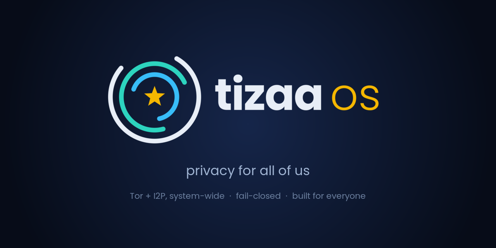
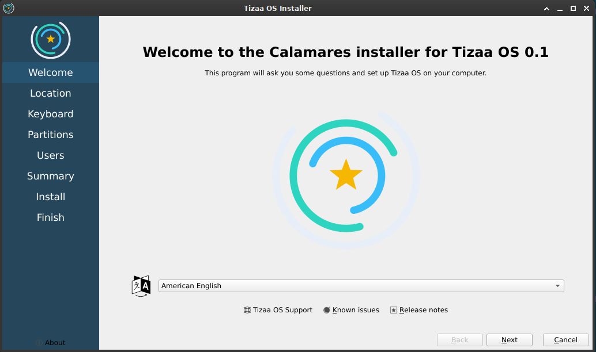

  

  
  
  
  

# Tizaa OS

**Privacy and anonymity, for all of us.**

Tizaa OS is an open-source operating system that sends every connection through **Tor** or **I2P**, or not at all. It is built for journalists, activists, whistleblowers, dissidents, and ordinary people who simply want to own their privacy, without needing to be security experts.

## Why "Tizaa"?

*Ti zaa* means **"all of us"** in Dagbanli, the language of the Dagomba people of northern Ghana. The name carries the idea behind the project: **everybody deserves privacy and secure communication**, not only the few who know how to configure it.

## What it does today (0.1.1)

- **Fail-closed leak guard.** A firewall that lets only the Tor and I2P services reach the internet. Any other program that tries to connect directly is blocked. If Tor or I2P stops, nothing leaks: everything stops.
- **Tor and I2P together, system-wide.** Tor for the web and `.onion` sites; I2P for `.i2p` sites. Two separate browsers keep the two identities from ever being linked.
- **Tor Browser on the system Tor**, the same model Tails uses, fetched and signature-verified at build time.
- **A sealed I2P browser** that can only reach `.i2p` sites and refuses the clear web.
- **Quiet by design.** Background services that leak on an ordinary desktop (mDNS, printer and scanner discovery, time sync, update timers, hostname lookups) are switched off. A fresh boot makes zero direct connection attempts.
- **The Freedom Center.** One simple window: green lights for *Leak guard*, *Tor* and *I2P*, plain words, and one button for each safe browser.
- **Live or installed.** Run it from a USB stick in memory (nothing is written to the computer), or install it with full-disk encryption using the built-in installer.
- **Fresh identity everywhere.** No Tor or I2P keys and no personal data are shipped in the image; each machine creates its own.

## Screenshots

  
  

  

## How it works

  

## Project status

Tizaa OS is a **development preview**. It boots, protects, and installs in our tests, but it has **not yet been independently audited** and has been tested mostly in virtual machines.

> **If your safety depends on anonymity today, please use a mature, audited system such as [Tails](https://tails.net/) while Tizaa OS grows.** We will say clearly when Tizaa OS is ready for high-risk use.

## Roadmap

| Version | Theme | Planned features |
|---|---|---|
| 0.2 | Safe by default | Updates over Tor, MAC address randomisation, safe time sync, emergency wipe, no admin by default in live mode |
| 0.3 | Works under censorship | Bridges (obfs4, Snowflake, WebTunnel) and a **smart router** that detects blocking and switches route automatically |
| 0.4 | Publish and discover | One-click **"Publish my site"** (`.onion` and `.i2p`) and a curated, verified directory of trustworthy resources |
| 0.5 | Protected storage | Encrypted vault, crypto-shredding, and encrypted data scattered across anonymity networks |
| 0.6 | On-device AI | AI/ML agents that run **fully offline**: a censorship-aware smart router, a metadata scrubber for documents and photos, and a safety assistant in local languages |
| 1.0 | Public release | Independent security review, testing on many laptops, signed releases, [tizaa.org](https://tizaa.org) |
| Later | Mobile | A Tizaa app for Android first, then a mobile OS |

## Try it

1. Download the ISO from [Releases](../../releases) and check its fingerprint:
   - Linux/macOS: `sha256sum tizaa-os-0.1.1-amd64.hybrid.iso`
   - Windows: `certutil -hashfile tizaa-os-0.1.1-amd64.hybrid.iso SHA256`
   - It must match the `SHA256SUMS` file published with the release.
2. **VirtualBox:** New VM, type *Linux / Debian (64-bit)*, tick **Skip Unattended Installation**, 4 GB RAM, 2 CPUs, **EFI on**, 25 GB disk; in *Display*, VMSVGA with 128 MB. Start and choose **Start Tizaa OS**.
3. **USB stick:** write the ISO with a tool such as [balenaEtcher](https://etcher.balena.io/) and boot from it.

Live session user: `tizaa` (logs in automatically).

## Built on

[Debian](https://www.debian.org/) 13 · [Tor](https://www.torproject.org/) and Tor Browser · [i2pd](https://i2pd.website/) · [Xfce](https://xfce.org/) · nftables · [Calamares](https://calamares.io/) · live-build. Tizaa OS is an independent project and is not affiliated with or endorsed by these projects.

## About the project

Tizaa OS is designed and built by **Siddique Abubakr Muntaka**, PhD candidate (ABD) in Information Technology at the **University of Cincinnati**, MIRAGe-UC Lab, advised by **Dr. Jacques Bou Abdo**.

It grew out of the dissertation research *Mapping the Invisible Internet*, a measurement, modelling and security study of the I2P anonymity network, and turns that research into a tool anyone can use.

## Feedback

Tizaa OS is young, and feedback shapes it. Please [open an issue](../../issues) for bugs, ideas, translations, or hardware reports. Security issues: please report privately (contact details coming with tizaa.org).

## License

Tizaa OS's own code and artwork are released under the **GNU General Public License v3.0**. Included software keeps its own licenses; the Poppins font is under the SIL Open Font License 1.1.
